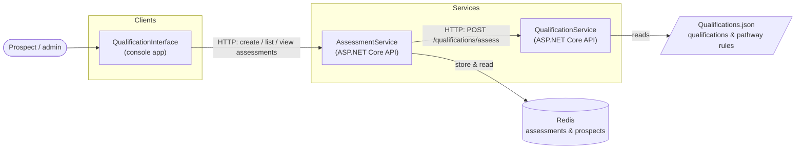

# CNA371-Microservices-for-Qualifications

A small .NET 10 microservices system that assesses whether a prospective student is eligible for a set of qualifications. A prospect enters their school results and completed qualifications in a console app. The system checks them against each qualification's admission pathways and reports where the prospect is eligible, or which requirements they're missing for each pathway.

## Architecture



| Component | Responsibility |
|---|---|
| **QualificationInterface** | Interactive console menu: run a new assessment, list all assessments, list a prospect's assessments by email, view one assessment by ID, or clear the screen. |
| **AssessmentService** | Owns prospects and assessments. When an assessment is created it saves the prospect (reusing an existing prospect with the same email and updating their name), asks the QualificationService to evaluate eligibility, and stores the result in Redis. |
| **QualificationService** | Owns the qualifications and their admission pathways (in `Qualifications.json`): the Diploma in Information Technology (DIT), Bachelor of Information Technology (BIT) and Bachelor of Computing (BCOMP). Evaluates a prospect's results against every pathway and returns, per qualification, whether they're eligible or which requirements each pathway is missing. |
| **Redis** | Storage for the AssessmentService: assessments, prospects, an email-to-prospect lookup, and the list of assessments for each prospect. |

## Running the system

You need the [.NET 10 SDK](https://dotnet.microsoft.com/download) to run locally, and Docker Desktop for the other two options.

All three options use the same ports on your machine, so run only one at a time.

| | URL |
|---|---|
| AssessmentService | http://localhost:5000/scalar/v1 |
| QualificationService | http://localhost:5054/scalar/v1 |
| Redis | `localhost:6379` |

### Option 1: Docker Compose

```
docker compose up -d --build
docker compose attach qualification-interface
```

The menu was printed before you attached, so the screen may start blank. Type a menu option and press Enter. To detach and leave the client running, press **Ctrl+P** then **Ctrl+Q**.

Stop everything with `docker compose down`. Redis data is not persisted.

### Option 2: Kubernetes (Docker Desktop)

Needs Kubernetes enabled in Docker Desktop (Settings → Kubernetes). The cluster pulls the images from Docker Hub, so the deploy script publishes them first (see [Publishing to Docker Hub](#publishing-to-docker-hub)). Run these from the repo root in PowerShell after `docker login`:

```
.\k8s\deploy.ps1    # build, push to Docker Hub, deploy and restart the pods
.\k8s\client.ps1    # start an interactive client session (removed on exit)
```

Choose **0** to exit the client. The pod is then removed. If the session is cut off without exiting (for example, you close the terminal), the client pod keeps running. Reconnect to it with:

```
.\k8s\client-resume.ps1
```

As with Docker Compose, the menu may not be on screen when you reconnect. Type an option and press Enter. While a leftover pod is running, `client.ps1` can't start a new one. Exit the leftover client first, or remove it with `kubectl delete pod qualification-interface -n qualifications`.

Everything runs in the `qualifications` namespace. Check on it with `kubectl get pods,svc -n qualifications`, and remove it with `kubectl delete namespace qualifications`. Redis data is not persisted here either.

The manifests always use the `latest` image tags. If you set `TAG` (see below), `deploy.ps1` builds and pushes that tag, but the cluster still runs `latest`.

### Option 3: Locally with `dotnet run`

Start Redis, then each project in its own terminal:

```
docker run -d -p 6379:6379 redis:7-alpine
dotnet run --project services/QualificationService --launch-profile http
dotnet run --project services/AssessmentService --launch-profile http
dotnet run --project clients/QualificationInterface
```

The client connects to `http://localhost:5000` by default. To point it at another AssessmentService, pass the URL as the first argument or set `ASSESSMENT_SERVICE_URL`. Docker Compose sets it from `clients/QualificationInterface/.env`.

## Publishing to Docker Hub

The images are published as `ryandewet577645/qualification-service`, `ryandewet577645/assessment-service` and `ryandewet577645/qualification-interface`. Redis uses the official image.

```
docker login
docker compose build
docker compose push
```

The tag defaults to `latest`. To publish a version, set `TAG` first, for example in PowerShell:

```
$env:TAG = "1.0.0"
docker compose build
docker compose push
```

To run the published images on another machine without the source code, see [Running the system on another machine from Docker Hub](docs/how-to-run-using-docker-hub.md).

## API overview

**AssessmentService**

| Method | Route | Description |
|---|---|---|
| `POST` | `/eligibilityassessment` | Run and store a new assessment |
| `GET` | `/eligibilityassessment` | List all assessments |
| `GET` | `/eligibilityassessment/{id}` | Get one assessment |
| `GET` | `/eligibilityassessment/prospect/{email}` | List a prospect's assessments |
| `POST` | `/prospect` | Create or update a prospect |
| `GET` | `/prospect/{id}` | Get a prospect by ID |
| `GET` | `/prospect/email/{email}` | Get a prospect by email |

**QualificationService**

| Method | Route | Description |
|---|---|---|
| `GET` | `/qualifications` | List qualifications |
| `GET` | `/qualifications/{id}` | Get one qualification |
| `POST` | `/qualifications/assess` | Evaluate eligibility for all qualifications |

The `tests/` folder has sample request bodies for `POST /eligibilityassessment` and `POST /qualifications/assess`.

## Repository layout

```
clients/QualificationInterface   console client
services/AssessmentService       assessments & prospects API (Redis)
services/QualificationService    qualifications & eligibility rules API
docs/                            additional guides
k8s/                             Kubernetes manifests and deploy/client scripts
tests/                           sample request payloads
docker-compose.yml               full stack for Docker Compose
```